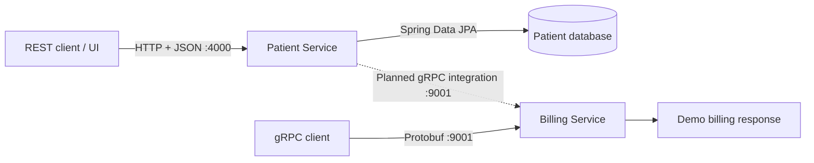

# Spring Boot Microservice Application

A Java and Spring Boot microservices project simply for learning purpose of how REST API and gRPC. Each service has its own Maven build and Dockerfile, demonstrating how independently packaged services can use different communication protocols.

**Project status:** work in progress. Patient CRUD logic and a demo billing RPC are implemented. The patient-side gRPC client is unfinished and currently prevents the patient service from compiling; creating a patient does not yet call the billing service.

## Architecture



| Component | Responsibility | Port |
| --- | --- | --- |
| Patient Service | Patient CRUD, validation, DTO mapping, and database access | `4000` HTTP |
| Billing Service | `CreateBillingAccount` unary gRPC method | `9001` gRPC |
| Billing HTTP server | Spring Boot web server; no billing REST controller is implemented | `4001` HTTP |
| Patient database | Patient records with UUID identifiers and unique email addresses | Depends on database configuration |

The patient service uses a layered structure:

```text
REST controller → service → repository → database
                      ↕
                 DTO / mapper / entity
```

`PatientController` handles HTTP requests, `PatientService` applies patient operations and duplicate-email checks, and `PatientRepository` provides Spring Data JPA persistence. DTOs separate API payloads from the entity, while `GlobalExceptionHandler` supplies error responses.

The billing service extends the generated `BillingServiceImplBase`. Its current implementation returns the fixed account ID `1234` and status `Active`; it does not persist billing accounts or process payments.

## REST and gRPC: different use cases

| Aspect | REST API | gRPC |
| --- | --- | --- |
| Use in this project | Manage patient resources | Request creation of a billing account |
| Typical caller | Frontend, external integration, curl, or API client | Another backend service or a gRPC client |
| Contract | HTTP routes, verbs, JSON DTOs, and OpenAPI | Services and messages declared in a `.proto` file |
| Java implementation | Spring MVC controllers and request/response DTOs | Generated Java messages, client stubs, and server base classes |
| Data transfer | JSON over HTTP | Protocol Buffers over HTTP/2 |
| Useful when | Clients benefit from standard HTTP tooling and readable payloads | Services benefit from a typed contract and generated clients |

REST fits actions such as listing patients for an admin screen, submitting registration data, updating an address, and deleting a record. gRPC fits an internal operation such as asking the billing service to create an account using a patient's ID, name, and email.

The intended combined flow is: a client submits a REST registration request, the patient service saves the patient, and the patient service calls billing through gRPC. **Only the patient persistence portion is currently wired into registration.** Decisions about billing failures, retries, and consistency between services remain future work.

gRPC also supports streaming RPCs, but this project defines only a unary call: one request produces one response.

## Java and Maven

The service POMs declare Java **21**, Spring Boot **4.1.1**, and gRPC **1.83.1**. The patient service includes Spring MVC, Spring Data JPA, Jakarta Validation, PostgreSQL and H2 drivers, and Springdoc OpenAPI. The billing service uses the `net.devh` gRPC Spring Boot starter.

Each service is a separate Maven project; there is no root aggregator `pom.xml`. Maven manages dependencies, compiles Java, runs tests, and packages executable Spring Boot JARs.

Both builds use `protobuf-maven-plugin` to generate Java message classes and gRPC service/client code from `src/main/proto/billing_service.proto`. `os-maven-plugin` selects platform-specific compiler binaries. Generated files belong under `target/generated-sources/` and should not be edited manually.

The protobuf contract currently exists in both services. Keep the two copies synchronized when changing the RPC contract.

## Repository layout

```text
patient-management/
├── patient-service/
│   ├── src/main/java/com/pm/patientservice/
│   │   ├── controller/       # REST endpoints
│   │   ├── service/          # Patient operations
│   │   ├── repository/       # JPA persistence
│   │   ├── model/            # Patient entity
│   │   ├── dto/              # API payloads and validation groups
│   │   ├── mapper/           # Entity/DTO conversion
│   │   ├── exception/        # API error handling
│   │   └── grpc/             # In-progress billing client
│   ├── src/main/proto/       # Billing contract
│   ├── src/main/resources/   # Configuration and sample SQL data
│   ├── pom.xml
│   └── Dockerfile
├── billing-service/
│   ├── src/main/java/com/pm/billingservice/grpc/
│   ├── src/main/proto/       # Billing contract
│   ├── pom.xml
│   └── Dockerfile
├── api-requests/             # REST request examples
└── grpc-requests/            # gRPC request examples
```

## Build and run locally

Prerequisites: JDK 21 and access to Maven dependency repositories. Each service includes a Maven wrapper, so a separate Maven installation is optional. Use `mvnw.cmd` in place of `./mvnw` on Windows.

### Current build blockers

Before building the patient service, finish [BillingServiceGrpcClient.java](patient-service/src/main/java/com/pm/patientservice/grpc/BillingServiceGrpcClient.java): it contains an unresolved `@GrpcService` annotation and an uninitialized final `blockingStub`. Its constructor is empty. The address placeholder `${billing.service.address.localhost}` also has no default or matching property in the checked-in configuration.

The commands below describe the build and launch workflow; the patient service requires those source issues to be resolved first. The REST request DTO also declares `setFirstName(...)` for its `name` field, which should be aligned before relying on JSON name binding.

### Start the billing service

From the repository root:

```bash
cd billing-service
./mvnw clean verify
./mvnw spring-boot:run
```

### Start the patient service

In another terminal, from the repository root:

```bash
cd patient-service
./mvnw clean verify
./mvnw spring-boot:run
```

The patient service includes H2 and PostgreSQL drivers. Its explicit H2 settings are commented out, and no PostgreSQL connection is configured. For a deliberate local H2 setup, enable the H2 configuration block in [application.properties](patient-service/src/main/resources/application.properties). It includes schema update and SQL initialization settings for the sample `data.sql` file. In-memory data is lost when the process stops.

For PostgreSQL, supply `SPRING_DATASOURCE_URL`, `SPRING_DATASOURCE_USERNAME`, and `SPRING_DATASOURCE_PASSWORD`, plus an appropriate schema initialization strategy. PostgreSQL is not provisioned by the application.

`clean verify` includes the existing tests and packaging. The current test classes are Spring context-loading tests, not comprehensive endpoint or integration coverage.

## REST API

Base URL: `http://localhost:4000`

| Method | Endpoint | Operation | Success status |
| --- | --- | --- | --- |
| `GET` | `/patients` | List patients | `200 OK` |
| `POST` | `/patients` | Create a patient | `200 OK` |
| `PUT` | `/patients/{id}` | Update a patient | `200 OK` |
| `DELETE` | `/patients/{id}` | Delete a patient | `204 No Content` |

IDs are UUIDs. There is currently no `GET /patients/{id}` endpoint.

```bash
curl http://localhost:4000/patients
```

The intended create payload is shown below; see the DTO binding issue noted above before trying it:

```json
{
  "name": "Alex Morgan",
  "email": "alex.morgan@example.com",
  "address": "100 Main Street",
  "dateOfBirth": "1990-05-15",
  "registeredDate": "2026-01-10"
}
```

Send it to `POST /patients` with `Content-Type: application/json`. Use ISO dates (`YYYY-MM-DD`). The create validation group requires `registeredDate`; updates do not require it and do not change it. Responses contain `id`, `name`, `email`, `address`, and `dateOfBirth`.

DTO validation and duplicate-email errors return `400 Bad Request`. The current handler also attempts to map patient-not-found errors to `400`; error handling should be refined as the API develops.

With the patient service running, explore its Springdoc endpoints:

- Swagger UI: `http://localhost:4000/swagger-ui/index.html`
- OpenAPI JSON: `http://localhost:4000/v3/api-docs`

An HTTP request example is available in [api-requests](api-requests/patient-service/get-patients.http).

## gRPC API

The [billing contract](billing-service/src/main/proto/billing_service.proto) declares:

```proto
service BillingService {
  rpc CreateBillingAccount(BillingRequest) returns (BillingResponse);
}

message BillingRequest {
  string patientId = 1;
  string name = 2;
  string email = 3;
}

message BillingResponse {
  string accountId = 1;
  string status = 2;
}
```

The Java package is `billing`; the protobuf service has no protobuf package, so its RPC path is `BillingService/CreateBillingAccount`.

With billing running and `grpcurl` installed, invoke it from the repository root:

```bash
grpcurl -plaintext \
  -import-path billing-service/src/main/proto \
  -proto billing_service.proto \
  -d '{"patientId":"123e4567-e89b-12d3-a456-426614174000","name":"Alex Morgan","email":"alex.morgan@example.com"}' \
  localhost:9001 BillingService/CreateBillingAccount
```

The demo response is:

```json
{
  "accountId": "1234",
  "status": "Active"
}
```

The included [gRPC request file](grpc-requests/billing-service/create-billing-account.http) can also be used in an IDE HTTP client that supports gRPC.

## Containerization

Both Dockerfiles use a multi-stage build:

1. **Build stage:** `maven:3.9.9-eclipse-temurin-21` resolves dependencies and runs `mvn clean package`, including tests.
2. **Runtime stage:** `eclipse-temurin:21-jre` receives the packaged JAR and starts it with `java -jar app.jar`.

Copying `pom.xml` before application sources allows Docker to reuse the dependency layer when only source code changes. The runtime image contains the JRE and application JAR without the Maven build tools.

Build from the repository root, using each service directory as its build context:

```bash
docker build -t billing-service:local ./billing-service
docker build -t patient-service:local ./patient-service
```

The patient image build is subject to the same source blockers described above. After successful builds, a local container setup is:

```bash
docker network create patient-management

docker run -d --name billing-service \
  --network patient-management \
  -p 4001:4001 -p 9001:9001 \
  billing-service:local

docker run -d --name patient-service \
  --network patient-management \
  -p 4000:4000 \
  -e SPRING_DATASOURCE_URL=jdbc:h2:mem:patientdb \
  -e SPRING_DATASOURCE_DRIVER_CLASS_NAME=org.h2.Driver \
  -e SPRING_JPA_HIBERNATE_DDL_AUTO=update \
  -e SPRING_JPA_DEFER_DATASOURCE_INITIALIZATION=true \
  -e SPRING_SQL_INIT_MODE=always \
  patient-service:local
```

This example explicitly uses an ephemeral H2 database. For persistent storage, configure an external PostgreSQL instance and its storage separately.

`EXPOSE` documents container ports; the `-p` flags publish them to the host. On the shared Docker network, a future patient gRPC client should connect to `billing-service:9001`. Inside a container, `localhost` refers to that container itself. Networking alone does not complete the unfinished Java client.

Inspect logs and stop the example containers with:

```bash
docker logs billing-service
docker logs patient-service
docker stop patient-service billing-service
docker rm patient-service billing-service
docker network rm patient-management
```

There is currently no Docker Compose file. The repository demonstrates service packaging, REST resource operations, and a protobuf-based billing RPC; automatic patient-to-billing integration and persistent billing storage remain to be implemented.
